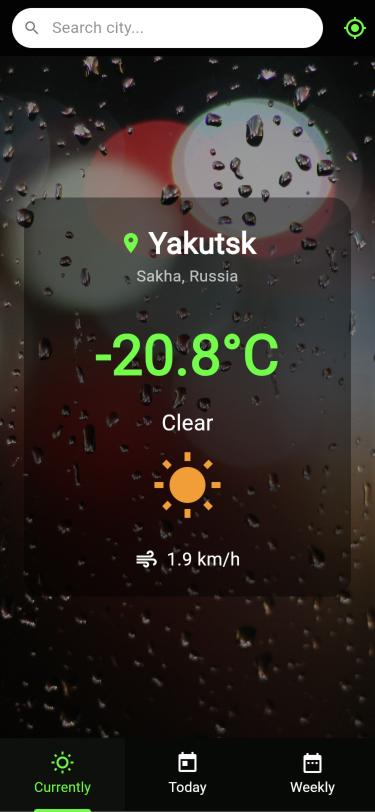
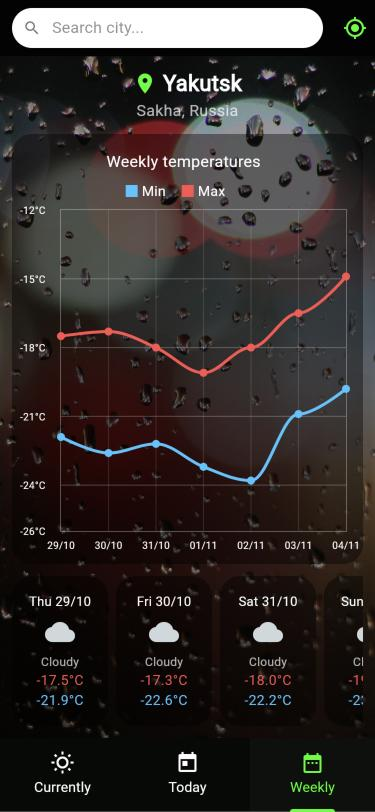

# Flutter Examples

Step-by-step Flutter exercises written in Dart: a calculator and a weather app
built in three levels. Each `ExNN` folder is its own Flutter project, and the
later exercises build on the earlier ones.

<p>
  
  &nbsp;
  
</p>

## Projects

| Folder | What it is |
| --- | --- |
| `calculator/Ex00` – `Ex02` | Calculator layout, step by step |
| `calculator/calculator_app` | Working calculator (`math_expressions`) |
| `junior_weather_app/Ex00` – `Ex01` | First steps: app bar, text, button |
| `medium_weather_app/Ex00` – `Ex03` | Tabs, search bar, geolocation, live weather |
| `advanced_weather_app/Ex00` – `Ex03` | Background image, styled tabs, today's chart |
| `advanced_weather_app/Ex04` | **Final app**: current, today and weekly forecasts with charts |

## Weather app (advanced_weather_app/Ex04)

- City search with suggestions (Open-Meteo geocoding), debounced as you type
- Weather at your location (`geolocator` + reverse geocoding)
- **Currently**: temperature, description, icon, wind speed
- **Today**: hourly temperature chart and an hourly list
- **Weekly**: min/max temperature chart and a daily list
- Clear error messages for no connection, unknown city or denied location

Data comes from [Open-Meteo](https://open-meteo.com) (no API key needed) and
[Nominatim](https://nominatim.org) for reverse geocoding.

```
lib/
├── advanced_weather_app.dart    # entry point (main)
├── models/                      # Place, WeatherData
├── services/                    # WeatherService (HTTP), LocationService
├── screens/home_screen.dart     # search, state, tabs
├── widgets/                     # tabs, chart, shared widgets
└── utils/weather_codes.dart     # WMO code → text / icon
```

## Running

Each exercise is a separate project. The weather apps use their own file name
as the entry point, so pass it with `-t`:

```bash
cd advanced_weather_app/Ex04
flutter pub get
flutter run -t lib/advanced_weather_app.dart
```

The calculator uses the default `lib/main.dart`:

```bash
cd calculator/calculator_app && flutter run
```

## Tests

```bash
cd advanced_weather_app/Ex04 && flutter test
cd calculator/calculator_app && flutter test
```

The weather tests use a fake HTTP client, so they run offline.
